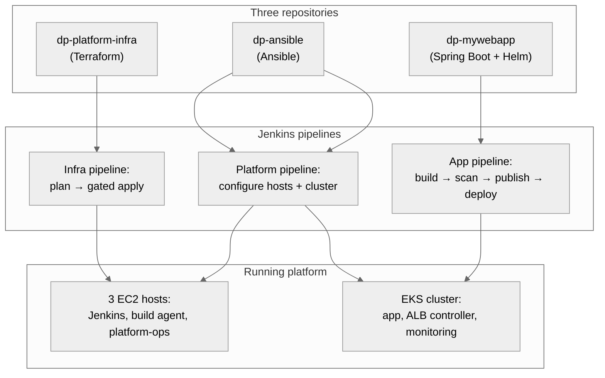
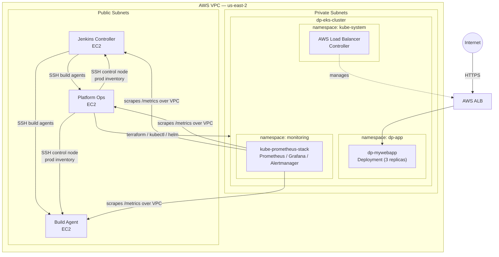

# DP Platform — Architecture

This document describes the overall architecture of the DP platform: three
EC2 hosts running a self-hosted CI/CD toolchain, an Amazon EKS cluster
running the application and its monitoring stack, and the AWS networking
and IAM boundaries that connect them.

The platform is built and operated across three repositories:

| Repository | Responsibility |
|---|---|
| [`dp-platform-infra`](../../dp-platform-infra) | AWS infrastructure (VPC, EC2, IAM, EKS) via Terraform |
| `dp-ansible` (this repo) | Host configuration, CI/CD toolchain, and cluster workloads via Ansible |
| [`dp-mywebapp`](../../dp-mywebapp) | The application deployed onto the platform |

For networking and SSH trust detail, see [`network.md`](network.md). For the
CI/CD flow, see [`pipeline.md`](pipeline.md). For a role-by-role breakdown of
this repository, see [`roles.md`](roles.md).

---

## Zoom out: repos → pipeline → runtime

Before the detailed system diagram in §1, here's the full picture in one
frame — three repositories, the pipelines that connect them, and the
running platform those pipelines produce:

Each repository owns exactly one pipeline and one concern — Terraform
never touches Kubernetes workloads, Ansible never builds the application,
and the application pipeline never touches infrastructure. The detailed
breakdown of each layer follows in the sections below, and the full
pipeline mechanics are in [`pipeline.md`](pipeline.md).

---

## 1. System overview

The platform has two halves that are easy to conflate but serve different
purposes:

- **The traditional EC2 layer** (Jenkins controller, build agent, platform
  ops) is the *permanent* control plane. It exists whether or not a
  Kubernetes workload is running, and it is what builds, scans, and
  publishes `dp-mywebapp`.
- **The EKS layer** is *ephemeral by design* (see §4). It is where the
  application actually runs once built, and where the monitoring stack for
  the whole platform lives.

Platform Ops is the hinge between the two: it is the only host with an AWS
IAM identity capable of driving Terraform, and the only host with
cluster-admin access to EKS. Jenkins and the build agent never hold AWS
credentials.

---

## 2. The three EC2 hosts

| Host | Instance type | Role |
|---|---|---|
| `jenkins-controller` | t3.medium | Runs Jenkins, JCasC-configured, orchestrates all pipelines |
| `build-agent` | t3.medium | Permanent Jenkins build agent — compiles, tests, scans, and publishes `dp-mywebapp` |
| `platform-ops` | t3.large | Holds the AWS IAM identity for Terraform and EKS; runs Ansible as the control node for prod; hosts JFrog Artifactory |

All three:
- Enforce IMDSv2 (`http_tokens = required`) — no legacy instance-metadata credential theft path
- Run encrypted gp3 root volumes
- Run a `node_exporter` instance, scraped by Prometheus once the EKS
  monitoring stack is live, so platform health and application health sit
  in one place

`platform-ops` is deliberately sized larger (t3.large vs t3.medium) because
it runs Terraform, Ansible, kubectl, Helm, and Artifactory concurrently —
the only host doing real compute work rather than just orchestration.

---

## 3. Identity and access boundaries

Two IAM roles exist for the EC2 fleet:

- **`platform_role`** (Jenkins controller, build agent) — SSM access and
  read-only EC2 visibility. Enough to be managed and observed; nothing
  more.
- **`platform_ops_role`** (platform-ops only) — the above, plus:
  - A Terraform-execution policy scoped so that `iam:PassRole` only works
    for two named role ARNs (`dp-eks-cluster-role`, `dp-eks-node-role`),
    conditioned on the service the role is being passed to
    (`eks.amazonaws.com` / `ec2.amazonaws.com`). Terraform can create and
    manage EKS infrastructure; it cannot pass arbitrary roles to arbitrary
    services.
  - A state-access policy scoped to `s3:ListBucket` on the state bucket
    and `Get/Put/DeleteObject` only under the `dp-platform/*` prefix.
  - EKS cluster-admin, granted via an `aws_eks_access_policy_association`
    against the current IAM access-entry model (`API_AND_CONFIG_MAP`),
    not the legacy `aws-auth` ConfigMap.

No EC2 host holds broad account-level permissions. The blast radius of a
compromised instance is defined explicitly by policy, not by convenience.

**The EKS cluster and node group have their own service roles**, separate
from the EC2 fleet's roles above — these are what `platform_ops_role`'s
scoped `PassRole` permission is actually granting access to:

- **`dp-eks-cluster-role`** — assumed by the EKS control plane service
  itself (`eks.amazonaws.com`), with `AmazonEKSClusterPolicy` attached.
  This is what allows AWS's managed control plane to operate on the
  cluster's behalf. Passed as `role_arn` on the `aws_eks_cluster`
  resource.
- **`dp-eks-node-role`** — assumed by EC2 instances once they join as
  worker nodes (`ec2.amazonaws.com`), with three policies attached:
  `AmazonEKSWorkerNodePolicy` (register with and be managed by the
  cluster), `AmazonEKS_CNI_Policy` (pod networking via the CNI plugin),
  and `AmazonEC2ContainerRegistryReadOnly` (pull images from ECR).
  Passed as `node_role_arn` on the `aws_eks_node_group` resource.

Platform Ops can create the cluster and node group, but only by handing
off to these two specific, narrowly-scoped roles — not by passing
arbitrary roles to arbitrary AWS services. This is the concrete thing the
`iam:PassRole` condition above is restricting access to.

**Workload identity inside the cluster** is handled separately, via **EKS
Pod Identity** rather than IRSA. The AWS Load Balancer Controller has its
own IAM role (`dp-aws-load-balancer-controller-role`), trusted only by
`pods.eks.amazonaws.com`, associated to the `aws-load-balancer-controller`
service account in `kube-system` via `aws_eks_pod_identity_association`.
Pod Identity removes the OIDC provider and per-role trust-policy management
that IRSA requires, and is AWS's current recommended mechanism for
granting AWS permissions to specific pods — the controller gets exactly
the AWS permissions it needs (sourced from AWS's own published policy for
the controller), and nothing the node's own role grants leaks into it.

---

## 4. Why EKS is ephemeral

The EKS cluster, its node group, the NAT Gateway, its Elastic IP, and the
private route table are all gated behind a single Terraform variable:
`enable_eks_runtime`. When `false`, none of these resources exist — no
idle NAT Gateway or EKS control plane accruing hourly cost while the
platform isn't actively being demonstrated or developed against.

This toggle is threaded through every layer that needs to agree on it:

| Layer | Variable |
|---|---|
| Terraform | `enable_eks_runtime` (bool, `terraform.tfvars`) |
| Ansible role defaults | `eks_runtime_enabled: false` |
| `dp-ansible` Jenkinsfile | `EKS_RUNTIME_ENABLED` parameter, default `false` |
| `dp-platform-infra` Jenkinsfile | `EKS_RUNTIME_ENABLED` parameter, default `true`; separate `TERRAFORM_APPLY` gate, default `false` |
| `dp-mywebapp` Jenkinsfile | `EKS_RUNTIME_ENABLED` parameter, default `false` |

All defaults fail closed — nothing EKS-dependent runs unless explicitly
turned on for that pipeline run.

---

## 5. What runs on the cluster

**`namespace: dp-app`** — `dp-mywebapp`, a Deployment of 3 replicas with an
attached Service, Ingress, HorizontalPodAutoscaler, and PodDisruptionBudget
(all toggleable via Helm values, not hardcoded). Kubernetes free-schedules
replicas across the two worker nodes; no manual placement is specified.

**`namespace: kube-system`** — the AWS Load Balancer Controller, installed
via Helm with 2 replicas. It does not carry application traffic itself —
it watches the cluster's Ingress objects and provisions/manages the
actual AWS Application Load Balancer via the AWS API. The ALB itself is an
AWS resource outside the cluster; the controller pods are its operator.

**`namespace: monitoring`** — `kube-prometheus-stack` (Prometheus,
Grafana, Alertmanager, the Prometheus Operator, kube-state-metrics, and a
node-exporter DaemonSet for the two EKS worker nodes). Each component has
explicit CPU/memory requests and limits set — deliberately, since the
cluster's node group runs on t3.medium and chart defaults are not sized
for that. Prometheus's storage uses an explicitly named StorageClass,
since the cluster does not define a default one, backed by the EBS CSI
driver addon.

Critically, Prometheus is not scoped to the cluster alone. Its
`additionalScrapeConfigs` reach outside Kubernetes entirely, over the VPC,
to the `node_exporter` running on all three EC2 hosts, and to the Jenkins
Prometheus plugin endpoint on the Jenkins controller. One monitoring plane
observes both the Kubernetes workload layer and the traditional
infrastructure layer underneath it.

---

## 6. Known gaps

Documented here rather than left silent, so this file stays accurate:

- **No ALB/TLS termination file yet.** `alb.tf` in `dp-platform-infra`
  exists as a placeholder and is currently empty. Ingress traffic today
  reaches the cluster through the ALB the Load Balancer Controller
  provisions on demand from the Ingress resource, not a separately
  managed load balancer.
- **`admin_ip` in `terraform.tfvars`** currently allows `0.0.0.0/0` to the
  Jenkins UI, SSH, and Artifactory UI security group rules. Intended to be
  narrowed before this is treated as a long-lived deployment rather than
  an active-development target.
- **Unused role stubs remain in the tree**: `roles/snyk`, `roles/datadog`,
  `roles/eksctl`, `roles/jfrog`, `roles/build_agent` are empty directories.
  Snyk is functional today via the Jenkins plugin/tool installer rather
  than a host-level role; Datadog is not currently integrated (node
  exporter + Prometheus is the observability stack in use); `jfrog` and
  `build_agent` were superseded by `artifactory` and `jenkins_agent`
  respectively and left in place rather than deleted.
