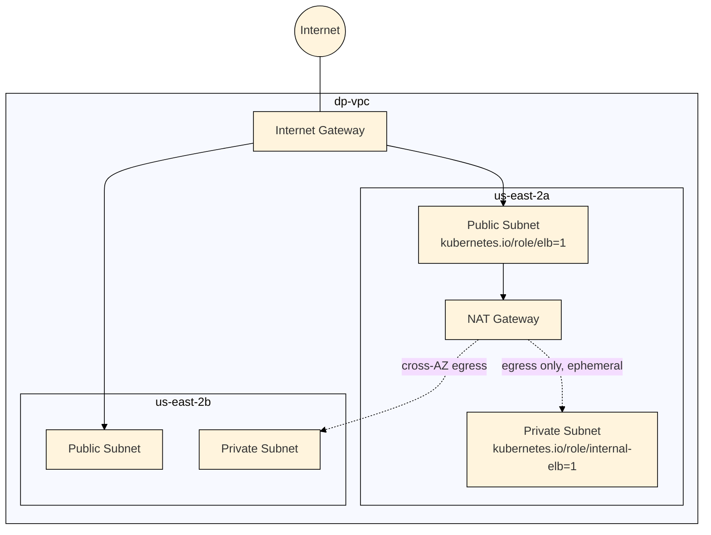
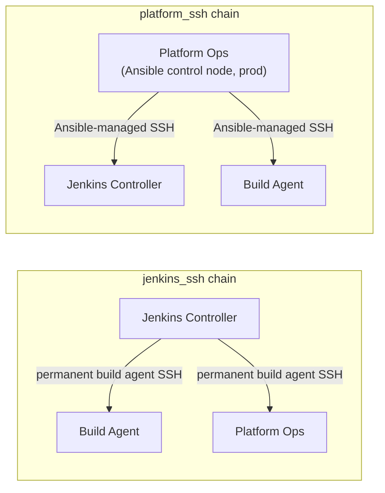

# DP Platform — Network & Access

This document covers the network layout, security group boundaries, EKS
access path, and the two independent SSH trust chains that let the
platform's hosts operate on each other. For the higher-level system
picture, see [`architecture.md`](architecture.md).

---

## 1. VPC layout

Both AZs' private subnets route their egress through the single NAT
Gateway in `us-east-2a` — `us-east-2b`'s private route table points at it
across the AZ boundary, which is the single-NAT tradeoff called out below.

- **Public subnets** (one per AZ) host the three EC2 instances and are
  tagged `kubernetes.io/role/elb = 1`, so any internet-facing load balancer
  Kubernetes provisions knows to use them.
- **Private subnets** (one per AZ) are tagged
  `kubernetes.io/role/internal-elb = 1` and are where the EKS cluster and
  node group live, when the EKS runtime is enabled.
- **A single NAT Gateway**, in `us-east-2a` only — a deliberate
  cost/redundancy tradeoff for a project at this stage: one NAT Gateway
  rather than one per AZ. If `us-east-2a` has an availability issue,
  private-subnet egress in `us-east-2b` would be affected too. Acceptable
  for the current scale; the first thing to revisit if this became a
  production, uptime-sensitive deployment.
- The NAT Gateway, its Elastic IP, and the private route table only exist
  when `enable_eks_runtime = true` (see `architecture.md` §4) — they cost
  money continuously while they exist, and the private subnets have no
  reason to route anywhere until EKS worker nodes are actually running in
  them.

---

## 2. Security groups

Each EC2 host has its own security group, plus the EKS cluster gets one
managed by AWS. Access between them is explicit, not blanket:

| From | To | Port | Purpose |
|---|---|---|---|
| `admin_ip` (var) | Jenkins controller SG | 22, 8080 | Operator SSH + Jenkins UI |
| `admin_ip` (var) | Build agent SG | 22 | Operator SSH |
| `admin_ip` (var) | Platform Ops SG | 22, 8082 | Operator SSH + Artifactory UI |
| Jenkins controller SG | Build agent SG | 22 | Jenkins → agent, permanent SSH build agent |
| Jenkins controller SG | Platform Ops SG | 22 | Jenkins → agent, permanent SSH build agent |
| Platform Ops SG | Jenkins controller SG | 22 | Ansible control node (prod) → managed host |
| Platform Ops SG | Build agent SG | 22 | Ansible control node (prod) → managed host |
| Platform Ops SG | EKS cluster SG | 443 | Platform Ops → EKS private API endpoint |

**`admin_ip` is currently set to `0.0.0.0/0`** in `terraform.tfvars`. This
is a named, explicit variable rather than a hardcoded value, which makes
it a one-line fix — but as written today it means SSH, the Jenkins UI, and
the Artifactory UI are reachable from the public internet. Flagged here
deliberately: this is the first thing to narrow to a specific IP or CIDR
before this deployment is treated as anything other than an active
development target.

---

## 3. How Platform Ops reaches the EKS API

Getting from "an IAM role exists" to "platform-ops can actually run
`kubectl` against the cluster" takes two separate mechanisms working
together — an IAM grant and a network path. Missing either one breaks
access, so both are documented here as a single unit rather than split
across an IAM section and a networking section.

**IAM side** — a two-step grant, per AWS's current EKS access model:

1. `aws_eks_access_entry.platform_ops` registers `platform_ops_role`'s ARN
   as a `STANDARD` principal known to the cluster. An access entry must
   exist before any policy can be associated with that principal — this
   step alone grants no permissions, it just makes the identity
   recognized.
2. `aws_eks_access_policy_association.platform_ops_admin` attaches
   `AmazonEKSClusterAdminPolicy` to that entry, with `access_scope.type =
   "cluster"` — cluster-wide administrative access, not scoped to a single
   namespace.

This is the `API_AND_CONFIG_MAP` authentication mode (see
`architecture.md` §3) — access entries are the current AWS-recommended
mechanism, replacing the older pattern of editing the `aws-auth`
ConfigMap by hand inside the cluster.

**Network side** — a dedicated `aws_vpc_security_group_ingress_rule`
permits the Platform Ops security group to reach the EKS cluster's own
security group on port 443. Without this rule, the IAM grant above is
irrelevant — platform-ops would be an authorized identity with no network
path to present its credentials to the cluster's private API endpoint.
The cluster's `vpc_config` has both `endpoint_private_access` and
`endpoint_public_access` enabled, but platform-ops reaches it via the
private path over the VPC.

The result: platform-ops is both a recognized cluster-admin identity *and*
has a network route to the endpoint that identity needs to reach — the two
halves of "can actually run kubectl" are each represented by their own
resource, rather than assumed.

---

## 4. Two independent SSH trust chains

The platform has two separate control planes that each need SSH access to
the other hosts, and each gets its **own** ed25519 identity rather than
sharing one:

- **`jenkins_ssh`** — Jenkins Controller's own identity, used because
  Jenkins runs its builds on `build-agent` and `platform-ops` as permanent
  SSH-connected agents. This is Jenkins acting as the CI orchestrator.
- **`platform_ssh`** — Platform Ops's own identity, used because in the
  production inventory (`hosts-prod.yml`), platform-ops *is* the Ansible
  control node — it's the host that runs `ansible-playbook` against the
  other two. This is Platform Ops acting as the configuration-management
  control node.

These are deliberately not the same key. Jenkins-as-CI-orchestrator and
Platform-Ops-as-Ansible-control-node are different roles with different
blast radii; a compromise of one identity doesn't hand over the other's
access.

Both roles follow an identical, idempotent pattern:

1. **Keygen** — generate an ed25519 keypair if one doesn't already exist
   (idempotent: safe to re-run without rotating an existing key
   unintentionally).
2. **`known_hosts` registration** — `ssh-keyscan` each target host and
   register its host key, so the first real connection isn't an
   interactive trust prompt that would hang an unattended pipeline.
3. **Distribution** — the public key is pushed to each target host's
   `authorized_keys` via a `delegate_to` loop.
4. **Live verification** — the role's final task actually opens an SSH
   connection to each target (`ssh ... "echo SSH_OK && hostname"`) and
   fails the playbook run if it doesn't succeed. Trust is proven at the
   end of the play, not assumed from the preceding steps having run
   without error.

That last step matters in practice: SSH trust can look configured (keys
distributed, `authorized_keys` written) while still being broken (wrong
permissions, wrong user, a stale host key) — the verification task is what
turns "we ran the steps" into "we confirmed it actually works."
