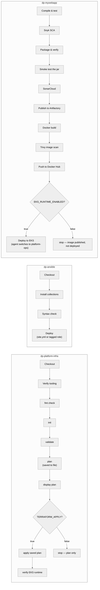

# DP Platform — CI/CD Pipeline

This document covers how code moves from commit to running workload
across the three Jenkins pipelines in this platform, and how Jenkins
itself gets configured in the first place. For the hosts and network
these pipelines run on, see [`architecture.md`](architecture.md) and
[`network.md`](network.md).

---

## 1. Three pipelines, one Jenkins controller



Each repository owns its own `Jenkinsfile` and its own job in Jenkins —
they are not chained to trigger one another automatically. This is a
deliberate boundary: infrastructure changes, platform configuration
changes, and application changes are three different kinds of risk, and
keeping them as three separately-invoked pipelines means none of them
can accidentally cascade into the others.

---

## 2. Bootstrapping Jenkins itself

Before any of the three pipelines above can run, Jenkins has to exist and
be configured — and that configuration is itself deployed by Ansible,
which creates a chicken-and-egg problem: the `dp-ansible` Jenkinsfile
needs to decrypt an Ansible Vault to get secrets, but Jenkins doesn't
exist yet to hold that vault password as a credential the first time
around.

The solution used here: the Ansible Vault password is itself stored as a
Jenkins credential (`ansible-vault-password`), declared directly in JCasC
alongside every other credential Jenkins manages (SSH key, GitHub PAT,
SonarCloud token, Snyk token, Artifactory token, Docker Hub credentials).
On first bootstrap, the vault password is provided out-of-band (by
whoever is standing the platform up); from then on, every pipeline that
needs vault secrets — including the `dp-ansible` pipeline that re-runs
Jenkins's own configuration — pulls it from Jenkins itself via
`withCredentials`. Jenkins becomes self-sufficient for its own
reconfiguration after the first run.

This is why the vault password is handled the same way in every
Jenkinsfile that touches it:

```groovy
withCredentials([string(credentialsId: 'ansible-vault-password', variable: 'ANSIBLE_VAULT_PASSWORD')]) {
    sh '''
        set +x
        umask 077
        printf '%s' "$ANSIBLE_VAULT_PASSWORD" > .vault-pass
        ansible-playbook ... --vault-password-file .vault-pass
        rm -f .vault-pass
    '''
}
```

`set +x` stops the password from being echoed into Jenkins's build log,
`umask 077` ensures the temp file is only readable by the process that
created it, and the file is removed both at the end of the stage and
again in `post { always { ... } }` — so it's cleaned up even if the stage
fails partway through.

---

## 3. `dp-platform-infra` — infrastructure changes

Runs on the `platform-ops` agent, since that's the only host holding the
AWS IAM identity Terraform needs (see `network.md` §3 — no long-lived AWS
access keys are stored in Jenkins for this pipeline).

Two independent booleans control what this pipeline can do:

| Parameter | Default | Effect |
|---|---|---|
| `EKS_RUNTIME_ENABLED` | `true` | Whether the plan includes the ephemeral EKS runtime (cluster, node group, NAT Gateway — see `architecture.md` §4) |
| `TERRAFORM_APPLY` | `false` | Whether the plan is actually applied to AWS, or just computed and displayed |

The pipeline always runs `fmt -check`, `init`, `validate`, and `plan`
regardless of `TERRAFORM_APPLY` — so every push gets a validated,
human-readable plan output in the Jenkins console, even when nothing is
actually changed in AWS. The plan is saved to a file (`dp.tfplan`), and if
`TERRAFORM_APPLY=true`, the apply stage applies **that exact saved plan**
rather than re-running `terraform apply` fresh — this guarantees what
gets applied is exactly what was reviewed in the "Display Terraform Plan"
stage, with no possibility of drift between what a human saw and what
Terraform executes. The plan file is deleted in `post { always { ... } }`
regardless of outcome.

When both `EKS_RUNTIME_ENABLED` and `TERRAFORM_APPLY` are true, a final
verification stage runs `aws eks describe-cluster` and `kubectl get
nodes` — actual confirmation the cluster exists and is reachable, not an
assumption based on `terraform apply` exiting successfully.

---

## 4. `dp-ansible` — platform configuration

Runs on `platform-ops`. Installs its own Ansible collection dependencies
from `requirements.yml` at the start of every run (`ansible-galaxy
collection install -r requirements.yml -p ./collections`), so the
pipeline never depends on collections someone happened to install by hand
on the host previously — the run is reproducible from a clean workspace.

`EKS_RUNTIME_ENABLED` gates whether EKS-dependent roles (the AWS Load
Balancer Controller, `kube_prometheus_stack`) are allowed to execute,
mirroring the same variable's role in `dp-platform-infra`.

The full `site.yml` playbook configures all three hosts end to end. In
practice, this Jenkinsfile is also used for **targeted runs** against a
single role via Ansible tags — for example, validating just the
`kube_prometheus_stack` role in isolation
(`--tags kube_prometheus_stack`) without re-running the entire platform
configuration. This is the same underlying playbook and pipeline, invoked
with a narrower scope when only one component needs attention.

---

## 5. `dp-mywebapp` — application build, scan, and deploy

The only pipeline of the three that runs primarily on the permanent
`build-agent`, switching to `platform-ops` only for the final deployment
stage. Security scanning is embedded directly in the build path, not
bolted on afterward:

1. **Compile & test** (`mvn clean test`)
2. **Snyk SCA scan** — dependency vulnerability scan against a real
   Snyk org/project, before the build proceeds further
3. **Package & verify** (`mvn verify -DskipTests`) — also produces the
   JaCoCo coverage data SonarCloud consumes next
4. **Smoke-test the built jar** — actually launches the packaged
   executable and polls `/actuator/health` for up to 20 seconds before
   trusting it; the build fails if the jar doesn't come up healthy, not
   just if `mvn package` reports success
5. **SonarCloud static analysis**
6. **Publish the Maven artifact to Artifactory**
7. **Docker build**
8. **Trivy image scan** — `--severity HIGH,CRITICAL --exit-code 1`,
   scanning the image that was just built, before it's published anywhere
9. **Push to Docker Hub** (both `${BUILD_NUMBER}` and `latest` tags)
10. **Deploy to EKS** — conditional on `EKS_RUNTIME_ENABLED`, and the only
    stage in this pipeline that runs on `platform-ops` instead of
    `build-agent`, specifically because `platform-ops` is the host that
    holds AWS/EKS access. The deploy stage re-checks out the repo (a
    different agent means a different workspace), verifies its tooling
    and AWS identity, updates its kubeconfig, `helm lint`s the chart,
    then `helm upgrade --install`s it and waits on rollout status before
    printing the resulting Deployment/Pod/Service/Ingress/HPA/PDB state
    as final confirmation.

Steps 2 and 8 are the two points where a real vulnerability — in a
dependency or in the built container image — stops the pipeline before
that code or image reaches Docker Hub. Trivy's `--ignore-unfixed` flag
means the gate is on vulnerabilities that actually have an available fix,
rather than failing builds against issues nobody can currently act on.

---

## 6. Credentials Jenkins holds

All declared in JCasC, none held as long-lived AWS keys:

| Credential ID | Used by | Purpose |
|---|---|---|
| `ansible-vault-password` | `dp-ansible`, `dp-platform-infra` | Decrypt Ansible Vault secrets during a run |
| SSH key (jenkins_ssh role) | Jenkins agent connections | Permanent SSH build agents (`build-agent`, `platform-ops`) |
| GitHub PAT | Job/webhook configuration | Repository checkout and status reporting |
| SonarCloud token | `dp-mywebapp` | Static analysis upload |
| `snyk-token` | `dp-mywebapp` | SCA scan authentication |
| `artifactory-token` | `dp-mywebapp` | Maven artifact publish |
| `dockerhub-credentials` | `dp-mywebapp` | Image push |

AWS access for both `dp-platform-infra` and the EKS-deploy stage of
`dp-mywebapp` comes from the IAM role attached to the `platform-ops` EC2
instance itself — there is no AWS access key stored in Jenkins for either
pipeline to use.
